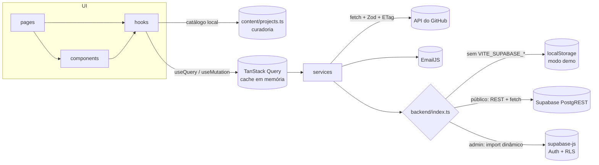

# Portfólio — CP3 · Stack e Harness Engineering

SPA de portfólio em **Vite + React 19 + TypeScript**, com projetos vindos da API do GitHub,
formulário de contato e painel administrativo protegido. Construída de ponta a ponta com um
agente de IA (Claude Code) conduzido por um **harness versionado**: regras em `CLAUDE.md`,
verificações automáticas em hooks de git e CI, e métricas medidas antes de cada otimização.

|                       |                                                                                                 |
| --------------------- | ----------------------------------------------------------------------------------------------- |
| **Demo**              | `https://<seu-projeto>.vercel.app` _(preencher após o deploy)_                                  |
| **Repositório**       | `https://github.com/<seu-usuario>/portfolio-cp3` _(preencher)_                                  |
| **Lighthouse mobile** | Performance **97–100** · Acessibilidade **100** · SEO **100** ([detalhes](docs/performance.md)) |
| **Testes**            | 71 testes (Vitest + Testing Library) · cobertura de 86% das instruções                          |

---

## Sumário

1. [Rodando o projeto](#1-rodando-o-projeto)
2. [Funcionalidades](#2-funcionalidades)
3. [Arquitetura](#3-arquitetura)
4. [Decisões de engenharia e trade-offs](#4-decisões-de-engenharia-e-trade-offs)
5. [Qualidade: testes, lint e CI](#5-qualidade-testes-lint-e-ci)
6. [Harness de IA](#6-harness-de-ia)
7. [Roteiro do vídeo (8 min)](#7-roteiro-do-vídeo-8-min)
8. [Deploy e configuração de serviços](#8-deploy-e-configuração-de-serviços)

---

## 1. Rodando o projeto

Requisitos: **Node 22.22+** (o `.nvmrc` fixa a 24).

```bash
npm install                    # também instala os hooks do Husky
cp .env.example .env.local     # preencha ao menos VITE_GITHUB_USERNAME
npm run dev                    # http://localhost:5173
```

> No PowerShell do Windows, se a política de execução bloquear o `npm`, use `npm.cmd`.

| Script                                 | O que faz                                                       |
| -------------------------------------- | --------------------------------------------------------------- |
| `npm run dev`                          | Servidor de desenvolvimento                                     |
| `npm run build`                        | Typecheck + build de produção em `dist/`                        |
| `npm run lint` / `lint:fix`            | Biome: lint, formatação e organização de imports                |
| `npm run typecheck`                    | TypeScript em modo strict                                       |
| `npm test` / `test:watch` / `coverage` | Vitest + Testing Library                                        |
| `npm run perf:bundle`                  | Bytes do carregamento inicial (gzip) e maiores chunks           |
| `npm run perf:lighthouse`              | Lighthouse mobile no build de produção (mediana de 3 execuções) |

### Variáveis de ambiente

Todas são **públicas** (prefixo `VITE_`, embutidas no bundle). Nenhum segredo de servidor vai
para o front-end. O `.env` real **nunca** é versionado: o `.gitignore` o ignora, um hook de
pre-commit bloqueia `git add -f` e o CI falha se algum `.env` aparecer no repositório.

| Variável                                                   | Obrigatória | Sem ela…                                          |
| ---------------------------------------------------------- | ----------- | ------------------------------------------------- |
| `VITE_GITHUB_USERNAME`                                     | Sim         | Páginas de projetos mostram aviso de configuração |
| `VITE_SUPABASE_URL` / `VITE_SUPABASE_ANON_KEY`             | Não         | App usa o **modo demonstração** (localStorage)    |
| `VITE_EMAILJS_SERVICE_ID` / `_TEMPLATE_ID` / `_PUBLIC_KEY` | Não         | Mensagem é só gravada no painel, sem e-mail       |

**Modo demonstração:** sem Supabase, o login do painel é `demo@portfolio.local` / `demo1234`
(exibido na própria tela). É seguro por construção: os dados ficam no `localStorage` de quem
acessa, então cada visitante só vê o próprio navegador.

---

## 2. Funcionalidades

- **Vitrine curada de projetos** — 6 projetos selecionados (públicos e privados) com nome de
  exibição, contexto, descrição, funcionalidades e tecnologias escritos à mão em
  [`src/content/projects.ts`](src/content/projects.ts). Nos públicos, a API do GitHub
  complementa com data do último push, porcentagem de linguagens e link do código. Busca (sem
  acento/maiúscula) e filtro por tecnologia guardados na URL (`?q=&tech=`); detalhe em URL
  canônica e legível, como `/projetos/pagina-de-vinhos`.
- **Vitrine na home** — até 3 projetos escolhidos no painel; sem escolha, os 3 primeiros do catálogo.
- **Contato** — React Hook Form + Zod, erros acessíveis por campo, botão bloqueado durante o
  envio, honeypot anti-bot; envia e-mail (EmailJS) e grava cópia no painel em paralelo.
- **Painel protegido** (`/admin`) — login, redirecionamento de volta à URL pedida, mensagens
  com filtro de não lidas, marcar lida/não lida e excluir com confirmação (atualização
  otimista com rollback), seleção de projetos em destaque.
- **Tema claro/escuro** — segue o sistema até o usuário escolher; escolha persistida e aplicada
  antes da primeira pintura (sem "flash").
- **Rotas** — 404 dentro do layout, página de erro que reconhece falha de chunk após deploy e
  sugere recarregar, `vercel.json` com rewrite de SPA (recarregar em qualquer URL funciona).

---

## 3. Arquitetura

### Camadas

```
src/
  pages/       Uma por rota. Compõe componentes e hooks. Única camada com default export (React.lazy).
  components/  UI reutilizável. Nunca chama fetch nem importa services/.
    ui/          Primitivos: Skeleton, FormField, StatusMessage.
    layout/      RootLayout, SiteHeader, SiteFooter.
    projects/    Cards, grid, filtros, linguagens do repositório.
    contact/     ContactForm.
    dashboard/   MessagesPanel, FeaturedPanel.
  hooks/       Ligam services ao React (TanStack Query) e lógica de UI reutilizável.
  services/    Acesso a APIs externas. Funções tipadas, sem React.
    backend/     Interfaces + implementações Supabase e modo demonstração.
  context/     Providers globais (tema, auth). Contexto em *-context.ts, Provider em *Provider.tsx.
  routes/      Árvore de rotas, guarda (ProtectedRoute), loaders lazy e caminhos.
  lib/         Utilitários: env tipado, QueryClient, schemas Zod, formatação, erros tipados.
  content/     Conteúdo editorial: catálogo curado de projetos (com teste de integridade).
  types/       Tipos de domínio (PortfolioProject, GithubRepo, ContactMessage, AuthUser…).
  test/        Setup e utilitários de teste (renderRoute, mockFetch, fixtures).
supabase/migrations/   Esquema SQL com Row Level Security.
scripts/               Guarda de .env, relatório de bundle, Lighthouse.
```

**Direção das dependências:** `pages → components / hooks → services → types`. `lib/` e
`types/` podem ser usados por todos. Erros que a UI precisa inspecionar (`GithubApiError`,
`BackendError`) moram em `lib/` justamente para componentes não importarem `services/`.

### Fluxo de dados



1. Componentes nunca chamam `fetch`. Pedem dados a um hook (`useGithubRepos`, `useAdminMessages`).
2. O hook usa TanStack Query com chaves hierárquicas (`['github', user, 'repos']`), o que dá
   cache, deduplicação, estados declarativos e invalidação.
3. O service faz a requisição, **valida a resposta com Zod** e converte para o tipo de domínio
   (`html_url` → `url`, `stargazers_count` → `stars`). Se a API mudar, quebra num lugar só.
4. O backend é escolhido em tempo de execução pela presença das variáveis do Supabase.
   Componentes só conhecem as interfaces `PublicBackend` / `AdminBackend`.
5. A vitrine (`usePortfolioProjects`) parte do **catálogo local** e apenas _complementa_ os
   projetos públicos com dados da API (`mergeWithGithub`). A lista aparece na hora e continua
   completa se a API falhar ou a cota acabar — só somem data e linguagens. Repositórios
   privados nunca são consultados (a API pública nem os enxerga).

### Economia da cota do GitHub (60 req/h por IP, sem token)

Token não pode ir para o front-end, então a API é usada sem autenticação. Quatro camadas
evitam esgotar a cota:

| Camada         | Mecanismo                                                                                          |
| -------------- | -------------------------------------------------------------------------------------------------- |
| Memória        | `staleTime` de 10 min: navegar entre páginas não refaz a requisição                                |
| Navegador      | Cache por **ETag** no localStorage: ao recarregar, o GitHub responde **304**, que não consome cota |
| Uma chamada só | Lista, detalhe e home usam a mesma consulta `/users/:user/repos`; o detalhe só busca as linguagens |
| Resiliência    | **stale-if-error**: com a cota esgotada ou sem rede, mostra a última versão salva                  |

Rate limit e 404 não têm retry (repetir só gastaria cota). A UI mostra o horário em que a
cota volta.

### Segurança

- **RLS no Supabase** ([migração](supabase/migrations/20261030000000_init.sql)): anônimo só
  **insere** mensagem e **lê** destaques; leitura/edição de mensagens e escrita de destaques
  exigem usuário em `admin_users`. A anon key é pública por design.
- Destaques são trocados por uma função SQL `security definer` atômica com checagem de admin.
- Redirecionamento pós-login passa por `safeRedirectPath()` (bloqueia open redirect).
- Links externos vindos da API passam por `toSafeExternalUrl()` (bloqueia `javascript:`).
- Cabeçalhos `nosniff`, `Referrer-Policy` e `X-Frame-Options` no `vercel.json`.

---

## 4. Decisões de engenharia e trade-offs

| Decisão           | Opções avaliadas                                         | Critério decisivo                                                                               | Escolha                                          | O que foi preterido e por quê                                                                                                                                                        |
| ----------------- | -------------------------------------------------------- | ----------------------------------------------------------------------------------------------- | ------------------------------------------------ | ------------------------------------------------------------------------------------------------------------------------------------------------------------------------------------ |
| Build / framework | Vite, Next.js, CRA                                       | Portfólio estático sem necessidade de SSR; deploy simples                                       | **Vite 8** (Rolldown)                            | Next.js: SSR/servidor sem benefício aqui e mais complexidade de deploy. CRA: descontinuado.                                                                                          |
| Roteamento        | React Router v6, **v8**, TanStack Router                 | API estável e conhecida, data router com `errorElement`                                         | **React Router v8**                              | O briefing citava v6, mas a v8 é a atual com a mesma API de SPA. TanStack Router: tipagem melhor, porém curva maior para o escopo.                                                   |
| Dados remotos     | `useEffect` + `fetch`, SWR, RTK Query, TanStack Query    | Cache, deduplicação, retry configurável, mutações otimistas                                     | **TanStack Query v5**                            | `useEffect`: reimplementar cache e corridas. RTK Query: exige Redux. SWR: mutações menos completas.                                                                                  |
| Estado global     | Redux, Zustand, Context                                  | Pouco estado de cliente (tema, sessão)                                                          | **Context API**                                  | Redux/Zustand: dependência para dois valores; dado remoto já está no Query.                                                                                                          |
| Estilo            | Tailwind v4, CSS Modules, styled-components              | Velocidade, tokens de tema, zero runtime                                                        | **Tailwind CSS v4**                              | styled-components: custo de runtime. CSS Modules: tokens e variantes de dark mode mais trabalhosos.                                                                                  |
| Validação         | Zod, **zod/mini**, Yup, Valibot                          | Um schema para form, env e API; tamanho                                                         | **zod/mini**                                     | Zod completo: 24,5 kB gzip contra 7,4 kB (API encadeada impede tree-shaking). Valibot: menor ainda, mas menos integrado ao ecossistema.                                              |
| Formulário        | Controlado, Formik, React Hook Form                      | Re-renders, integração com schema                                                               | **React Hook Form**                              | Formik: campos controlados (mais re-renders) e manutenção menos ativa. Controlado: rerender por tecla.                                                                               |
| Backend           | Supabase, Firebase, só mock                              | Postgres + RLS declarativo; funcionar sem conta                                                 | **Supabase + modo demo** (adapter)               | Firebase: regras menos expressivas que SQL. Só mock: não serviria para produção. O adapter permite rodar e testar sem conta.                                                         |
| Auth no modo demo | Mock JWT "criptografado", sessão simples                 | Honestidade sobre segurança                                                                     | **Sessão simples com expiração**                 | Criptografar no front é teatro: a chave estaria no bundle. Segurança real fica no Supabase (RLS).                                                                                    |
| Supabase no front | `supabase-js` em tudo, REST com `fetch`                  | Peso nas páginas públicas                                                                       | **REST nas públicas, supabase-js lazy no admin** | `supabase-js` em tudo: +54 kB gzip para todo visitante.                                                                                                                              |
| E-mail            | EmailJS, Formspree, função serverless                    | Sem backend próprio, sem SDK                                                                    | **EmailJS via REST**                             | Formspree: alternativa equivalente; EmailJS permite template de e-mail próprio sem backend. SDK do EmailJS: desnecessário para um único POST.                                        |
| Lint / format     | ESLint + Prettier, **Biome**                             | Velocidade, uma configuração                                                                    | **Biome 2**                                      | ESLint + Prettier: 2 ferramentas e mais plugins; Biome cobre a11y, hooks e nomes de arquivo.                                                                                         |
| Testes            | Jest, Vitest                                             | Mesma config do Vite, ESM nativo                                                                | **Vitest**                                       | Jest: configuração extra para ESM/TS e aliases.                                                                                                                                      |
| Fonte da vitrine  | Lista automática da API, catálogo curado, catálogo + API | Repositórios privados não aparecem na API; nomes de repo ruins de exibir; independência da cota | **Catálogo curado + API como complemento**       | Só API: perderia os privados e exibiria nomes como `Landing-Page---Tema-Livre-…`. Só catálogo: perderia datas e linguagens atualizadas. Custo: editar um arquivo ao incluir projeto. |
| Página inicial    | Lazy como as outras, estática                            | LCP no celular                                                                                  | **Estática** (vitrine lazy)                      | Lazy: +1 ida e volta antes do LCP. Custo: +3,6 kB no bundle inicial; ganho: LCP 2,51 s → 1,24 s.                                                                                     |
| Fontes            | Google Fonts, fontes do sistema                          | Zero download, zero FOUT/CLS                                                                    | **Fontes do sistema**                            | Web fonts: requisição extra e risco de CLS; a pilha serifada do sistema atende ao visual editorial.                                                                                  |
| Elemento 3D       | Three.js / R3F / Spline, nenhum                          | Custo × benefício para um portfólio de código                                                   | **Não incluído**                                 | Bundle de centenas de kB para efeito decorativo; contraria a direção visual sóbria.                                                                                                  |

---

## 5. Qualidade: testes, lint e CI

**71 testes**, cobertura de **86% das instruções / 87% das linhas**. Nenhum teste acessa a
rede: o setup bloqueia `fetch` e zera as variáveis `VITE_*`; cada teste declara o que precisa
com `mockFetch()` e `vi.stubEnv()`.

| Área                  | O que é coberto                                                                                                                                                                                                             |
| --------------------- | --------------------------------------------------------------------------------------------------------------------------------------------------------------------------------------------------------------------------- |
| Formulário de contato | Erros por campo, foco no primeiro inválido, `aria-describedby`, limite de caracteres, botão bloqueado durante envio, clique duplo grava uma vez, EmailJS, falha total mantém os dados, honeypot                             |
| Guarda de rotas       | Sem sessão → `/login`; sessão expirada; volta à URL pedida após login; credencial errada; logado em `/login` → `/admin`; logout bloqueia de novo; open redirect                                                             |
| Painel                | Filtro de não lidas, marcar como lida, excluir com confirmação, limite de 3 destaques e reflexo na home                                                                                                                     |
| Vitrine e GitHub      | Catálogo íntegro (slugs, textos, links), lista sem API, privados nunca consultados, cota esgotada sem erro, busca e filtro por tecnologia, detalhe público/privado; mapeamento da API, rate limit, ETag/304, stale-if-error |
| Tema e rotas          | Persistência, preferência do sistema, 404 no layout, erro de chunk, preload por intenção                                                                                                                                    |

**Barreiras automáticas**

| Quando                     | Verificação                                                               |
| -------------------------- | ------------------------------------------------------------------------- |
| `git commit` (pre-commit)  | Bloqueia `.env` real no stage; Biome nos arquivos alterados (lint-staged) |
| `git commit` (commit-msg)  | commitlint: Conventional Commits, linhas ≤ 100 caracteres                 |
| Push / PR (GitHub Actions) | Nenhum `.env` versionado → Biome → typecheck → testes → build             |

---

## 6. Harness de IA

### Modelo e ambiente

|                       |                                                                                            |
| --------------------- | ------------------------------------------------------------------------------------------ |
| Agente                | **Claude Code** (app desktop, Windows 11)                                                  |
| Modelo                | **Claude Opus 5.5** (`claude-opus-5-5`)                                                    |
| Ferramentas do agente | Terminal (PowerShell/Git Bash), edição de arquivos, navegador embutido para verificar a UI |
| Arquivo de regras     | [`CLAUDE.md`](CLAUDE.md) na raiz, lido automaticamente pelo Claude Code em toda sessão     |

### O que é o harness aqui

"Harness" é o conjunto de instruções e **verificações automáticas** que mantém o agente
consistente. O princípio usado: **toda regra importante do `CLAUDE.md` tem um verificador
automático**, porque uma instrução em texto pode ser esquecida, mas um hook não deixa passar.

| Regra no `CLAUDE.md`                             | Quem garante                                                                        |
| ------------------------------------------------ | ----------------------------------------------------------------------------------- |
| Conventional Commits                             | `commitlint` no hook `commit-msg`                                                   |
| Nunca versionar `.env`                           | `.gitignore` + `scripts/check-env-staged.mjs` (pre-commit e CI)                     |
| PascalCase / camelCase / kebab-case nos arquivos | Biome `useFilenamingConvention`                                                     |
| Export nomeado (default só em páginas)           | Biome `noDefaultExport` com override para `src/pages/`                              |
| Hooks no topo, sem imports não usados, a11y      | Biome (regras recomendadas + `useHookAtTopLevel`)                                   |
| `main` sempre verde                              | GitHub Actions: lint, typecheck, testes, build                                      |
| Lighthouse ≥ 80                                  | `npm run perf:lighthouse` + números registrados em `docs/performance.md`            |
| Camadas (`components` não importa `services`)    | Revisão do agente contra o `CLAUDE.md` (sem verificador automático; ver limitações) |

### Como a IA foi conduzida

1. **Briefing único** com stack de referência, regras de governança e as 6 fases.
2. **Uma fase por vez.** O agente analisava o estado atual, propunha o plano da fase e só
   executava após aprovação humana. Ao fim de cada fase: lint, typecheck, testes, build,
   verificação no navegador e commits; o merge na `main` dependia de novo aval.
3. **Restrições do humano incorporadas como regra:** "sem visual neon de IA" virou a seção
   _Identidade visual_ do `CLAUDE.md` (paleta com um único acento, lista de efeitos proibidos);
   "sem enviar o .env" virou duas barreiras automáticas.
4. **O `CLAUDE.md` evoluiu junto com o código** (commits `docs(harness): …`): a cada fase, os
   padrões novos (rotas, camada de dados, backend, performance) foram registrados para a
   sessão seguinte seguir.
5. **Medir antes de otimizar.** Na Fase 5 o agente criou scripts de medição antes de mudar
   qualquer código, e cada otimização tem número de antes e depois.

### Onde o harness pegou erros de verdade

| Situação                 | O que aconteceu                                                                                                                                                                                                                                |
| ------------------------ | ---------------------------------------------------------------------------------------------------------------------------------------------------------------------------------------------------------------------------------------------- |
| Hooks inativos no início | O primeiro commit saiu como "setup inicial" porque o Husky não tinha sido instalado (`npm install <pacote>` não roda o `prepare`). Detectado, hooks ativados, mensagem corrigida; daí em diante o commitlint recusou mensagens fora do padrão. |
| Mensagens longas         | O commitlint recusou commits com linhas de corpo acima de 100 caracteres (duas vezes).                                                                                                                                                         |
| Violação de camadas      | Duas vezes o agente fez componente/página importar `services/`. Revisando contra o `CLAUDE.md`, moveu `GithubApiError` e `BackendError` para `lib/`.                                                                                           |
| Bug pego por teste       | Ao salvar os destaques, a mensagem "Destaques salvos" sumia (o editor era remontado e perdia o estado da mutação). O teste falhou; a mutação subiu para o componente pai.                                                                      |
| Lint de acessibilidade   | Biome barrou SVG sem `<title>`, `var` mal posicionada no script inline e componente declarado dentro de função.                                                                                                                                |
| Medição contaminada      | O Lighthouse local mostrava 1,5 s de bloqueio vindo de um script de 185 kB que o antivírus injetava. O agente isolou a causa e passou a bloquear a URL na medição, registrando as duas versões.                                                |
| Falha de resiliência     | Medições repetidas esgotaram a cota do GitHub e mostraram que o app descartava dados em cache diante de um 403. Virou o padrão stale-if-error, com teste.                                                                                      |

### Decisões em que o agente divergiu do briefing (e registrou o porquê)

- **React Router v8** em vez de v6: é a versão atual, com a mesma API de SPA.
- **`zod/mini`** em vez do Zod completo: −70% no chunk de validação, medido.
- **Uma branch `feature/contact-dashboard`** em vez de duas: formulário e painel compartilham a
  camada de backend.
- **Sem "mock JWT criptografado"**: criptografia no front-end não protege nada; a segurança
  real está no RLS do Supabase.

### Limitações conhecidas

- A regra de camadas é verificada pelo agente, não por ferramenta. Próximo passo:
  `dependency-cruiser` ou regra `noRestrictedImports` no CI.
- O caminho com **Supabase real** e o envio pelo **EmailJS** estão implementados e cobertos com
  respostas simuladas, mas dependem de criar as contas para teste ponta a ponta.
- O Lighthouse foi medido localmente; falta confirmar em produção com o PageSpeed Insights.

---

## 7. Roteiro do vídeo (8 min)

Grave com o site aberto (Vercel ou `npm run preview`), o editor com o repositório e um terminal.
Tempo de fala de referência entre colchetes.

### Abertura — 0:00 a 0:20

> "Este é o meu portfólio do CP3. Vou mostrar a stack e a arquitetura, justificar as decisões
> com os trade-offs e explicar como conduzi a IA com um harness versionado."

**Tela:** home do site.

### Bloco 1 — Stack e arquitetura · 0:20 a 2:50 (~2,5 min)

| Tempo | Tela                                         | Fala (resumo)                                                                                                    |
| ----- | -------------------------------------------- | ---------------------------------------------------------------------------------------------------------------- |
| 0:20  | Home → Projetos → busca "react" → detalhe    | Tour: vitrine curada (públicos e privados), filtros na URL, detalhe em `/projetos/pagina-de-vinhos`.             |
| 0:50  | Alternar tema; recarregar                    | Tema persistido e aplicado antes da pintura, sem flash.                                                          |
| 1:05  | Contato: enviar vazio, depois preencher      | Validação acessível com RHF + Zod; botão bloqueia durante o envio.                                               |
| 1:25  | `/admin` → redireciona → login demo → painel | Rota protegida, volta à URL pedida; marcar como lida; escolher destaque e ver na home.                           |
| 1:55  | Editor: árvore `src/`                        | Camadas: pages → components/hooks → services → types. Componente nunca chama `fetch`.                            |
| 2:20  | Diagrama de fluxo no README                  | Hook → TanStack Query → service com Zod → GitHub / backend. Backend é Supabase ou modo demo, escolhido pelo env. |

### Bloco 2 — Justificativas e trade-offs · 2:50 a 5:20 (~2,5 min)

| Tempo | Tela                             | Fala (resumo)                                                                                                         |
| ----- | -------------------------------- | --------------------------------------------------------------------------------------------------------------------- |
| 2:50  | Tabela de trade-offs (README §4) | Vite em vez de Next: não preciso de SSR. TanStack Query em vez de `useEffect`: cache e estados prontos.               |
| 3:20  | `github-client.ts`               | Cota de 60 req/h sem token: cache em memória, ETag (304 não gasta cota), `initialData` e stale-if-error.              |
| 3:55  | `supabase/migrations/…sql`       | Segurança no RLS: anônimo só insere mensagem; admin via `admin_users`. Por isso não fiz "JWT criptografado" no front. |
| 4:25  | `docs/performance.md`            | Medi antes de otimizar: LCP da home 2,51 s → 1,24 s ao tirar a home do lazy; CLS 0,108 → 0; `zod/mini` −70%.          |
| 4:55  | Terminal: `npm run perf:bundle`  | Trade-off consciente: +3,6 kB no bundle inicial para eliminar uma ida e volta antes do LCP.                           |

### Bloco 3 — Harness de IA e condução · 5:20 a 7:50 (~2,5 min)

| Tempo | Tela                                                           | Fala (resumo)                                                                                                       |
| ----- | -------------------------------------------------------------- | ------------------------------------------------------------------------------------------------------------------- |
| 5:20  | `CLAUDE.md`                                                    | Regras de camadas, nomes, commits, branches e identidade visual "sem neon de IA", lidas pelo agente em toda sessão. |
| 5:50  | Tabela "Regra → quem garante" (README §6)                      | Princípio: toda regra importante tem verificador automático.                                                        |
| 6:15  | Terminal: `git commit --allow-empty -m "teste"` sendo recusado | O commitlint barra mensagem fora do padrão.                                                                         |
| 6:35  | Terminal: `git add -f .env.local` + commit recusado            | A guarda de `.env` funciona mesmo forçando.                                                                         |
| 6:55  | `git log --oneline`                                            | Histórico em Conventional Commits; commits `docs(harness)` mostram o `CLAUDE.md` evoluindo por fase.                |
| 7:15  | Tabela "Onde o harness pegou erros"                            | Exemplos reais: violação de camadas, bug pego por teste, medição contaminada pelo antivírus.                        |
| 7:35  | GitHub Actions verde                                           | CI repete tudo no servidor: a `main` só recebe código verde.                                                        |

### Fechamento — 7:50 a 8:00

> "Resumindo: stack enxuta e justificada, desempenho medido e um harness que transforma regras
> em verificações automáticas. Obrigado!"

> **Depois do passo 6:35:** tire o `.env.local` do stage com `git reset .env.local` — o hook
> já terá impedido o commit. Os dois comandos foram testados e não criam commit.

---

## 8. Deploy e configuração de serviços

### Vercel

1. Importe o repositório na Vercel (framework detectado: Vite; build `npm run build`; saída `dist`).
2. Em **Settings → Environment Variables**, cadastre as mesmas variáveis do `.env.example`.
3. O `vercel.json` já cuida do rewrite de SPA, cache imutável de `/assets` e cabeçalhos de
   segurança.

### Supabase (opcional — sem ele, o painel roda em modo demonstração)

1. Crie um projeto e rode `supabase/migrations/20261030000000_init.sql` no SQL Editor.
2. Em **Authentication → Users**, crie seu usuário; em **Providers → Email**, desative o
   cadastro público.
3. Torne-o admin: `insert into public.admin_users (user_id) values ('<uuid do usuário>');`
4. Preencha `VITE_SUPABASE_URL` e `VITE_SUPABASE_ANON_KEY`.

### EmailJS (opcional)

1. Crie um serviço e um template com as variáveis `from_name`, `reply_to`, `subject` e `message`.
2. Preencha `VITE_EMAILJS_SERVICE_ID`, `VITE_EMAILJS_TEMPLATE_ID` e `VITE_EMAILJS_PUBLIC_KEY`.

### Checklist de entrega

- [x] `VITE_GITHUB_USERNAME=sampaiodelvane` no `.env.local` (falta cadastrar na Vercel)
- [x] Descrição e funcionalidades dos 6 projetos da vitrine (`src/content/projects.ts`)
- [ ] Deploy na Vercel e links preenchidos no topo deste README
- [ ] Repositório no GitHub com o CI verde
- [ ] (Opcional) Supabase e EmailJS configurados
- [ ] Vídeo gravado seguindo a seção 7
